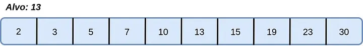
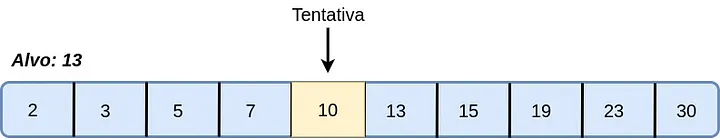
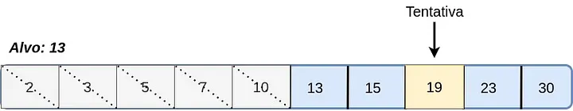
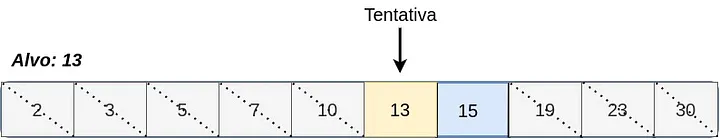

# Algorithms: Binary Search

> Classification: Search algorithm
>
> Running time (Big O Notation): O(log n)

A few days ago, I came across a show called *A Culpa é do Cabral* on TV. In this show, there was a segment called *“Jogo do balão”* (“The balloon game”), whose main idea is that the contestants answer general knowledge questions and, as time goes by, the balloon inflates. Every time a contestant answers correctly, they pass the balloon to the next contestant. The contestant holding the balloon when it pops loses the game. Simple, right?

In case it's still not clear, watch this 15-second clip from an episode of *A Culpa é do Cabral — Jogo do Balão* (in Portuguese):

<iframe width="560" height="315" src="https://www.youtube.com/embed/X-TTl-EM2_o?clip=UgkxlStXf8QW3wGEV30ptMk1pNhGAvnFoQJ5&amp;clipt=ENz_Axif9wQ" title="YouTube video player" frameborder="0" allow="accelerometer; autoplay; clipboard-write; encrypted-media; gyroscope; picture-in-picture; web-share" allowfullscreen></iframe>

Let's break down this dialogue between the host and the contestant.

Host — “According to IBGE, how many weddings does Brazil celebrate per day?”.

At this point the contestant makes their first guess: “20 thousand per day”.

The host then gives the contestant a hint and says: “Less!”.

The contestant makes a new guess: “10 thousand per day”. And the host gives another hint: “Less!”. Contestant: “200”. Host: “More!”, and it goes on… Until the contestant gets the right value of 3 thousand.

After all this you might be wondering: what does this have to do with binary search? Well, binary search is, fundamentally, __a way of finding a target value through guesses/hints within a sorted list!__

## Binary Search

Binary search is characterized by these three keywords: target, guess and hint.

Thinking about the *Balloon Game*, it's easy to define these three keywords.

Target = Number of weddings in Brazil per day (3 thousand)
Guess = The contestant's guesses (20 thousand, 10 thousand, 200…)
Hints = “Less!” and “More!”.
The difference between the contestant's guesses and the binary search algorithm is that the algorithm always checks the middle position of the list. If the middle value is smaller than the target value, the whole half before the middle is eliminated; if it's larger, the whole larger half is eliminated. Confused?

## Practical example

Imagine a list of 10 elements sorted in ascending order. The goal is to find the position of the number 13 — so the number 13 is the target.



Binary search will first check whether the middle element of the list is equal to the target. As we can see in the image below, the number 10 (guess) is smaller than 13 (target).



The algorithm will therefore eliminate all the numbers before the middle. From this, we can identify two important characteristics of binary search:

- Sorting is mandatory: This makes sense because if the list is sorted in ascending order and we know that the middle number (10) is smaller than the target (13), logically all the numbers before the middle will also be smaller than the target. If the list weren't sorted, it would be impossible to reach that conclusion.
- On each round of guessing, binary search __eliminates half of the elements__.

After eliminating the elements, it's time to make a new guess. The process repeats. The algorithm will check which element is in the middle of the remaining elements, as shown in the figure below.



Is element 19 (guess) equal to 13 (target)? No. So we'll eliminate all the elements to the right of the middle, because 19 is greater than 13.

After that, the process is carried out again. Since only two elements are left, the first one is considered the middle.



Yes! Our guess (13) is equal to the target (13)! Congratulations, the algorithm ran successfully.

> NOTE: As mentioned at the beginning, this algorithm has a logarithmic running time. This makes it very efficient for searching.
>
> E.g.: If we had a list of 4 billion elements, __the algorithm would find the target in at most 32 guesses__!

## Code
The code below implements a binary search algorithm in the Go programming language.

```go
package main

import "fmt"

func main() {
	fmt.Println("Binary Search...")

	list := []int{2, 3, 5, 7, 10, 13, 15, 19, 23, 30}
	position := binarySearch(list, 13)

	fmt.Println(position)
}

func binarySearch(list []int, target int) int {

	low := 0
	high := len(list) - 1

	for low <= high {
		middle := (high + low) / 2
		attempt := list[middle]

		if attempt == target {
			return middle
		}

		if attempt > target {
			high = middle - 1
		}

		if attempt < target {
			low = middle + 1
		}
	}

	return -1
}
```

One point about the code deserves attention:

- There are two variables that hold references to the start of the list (low) and the end of the list (high). When we eliminate the elements before the middle, the low variable is updated, pointing to the element right after the middle; when we eliminate the elements after the middle, the high variable is updated, pointing to the first element before the middle.

## References

- https://en.wikipedia.org/wiki/Binary_search_algorithm
- Learning Algorithms, by George Heineiman
- Grokking Algorithms — An illustrated guide for programmers and other curious people, by Aditya Y. Bhargava
