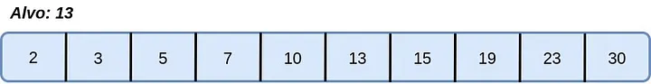
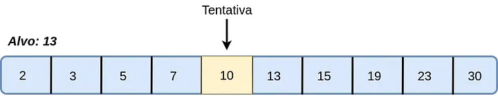
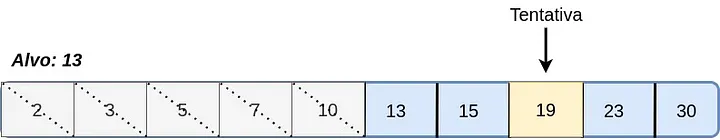
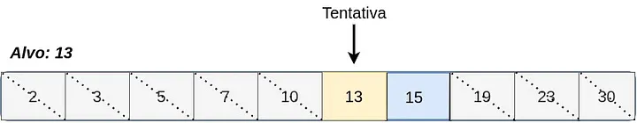

# Algoritmos: Búsqueda Binaria

> Clasificación: Algoritmo de búsqueda
>
> Tiempo de ejecución (Big O Notation): O(log n)

Hace unos días, me encontré con un programa llamado *A Culpa é do Cabral* en la televisión. En ese programa había una sección llamada *“Jogo do balão”* (“El juego del globo”), cuya idea principal es que los participantes respondan preguntas de cultura general y, a medida que pasa el tiempo, el globo se infla. Cada vez que un participante responde correctamente, le pasa el globo al siguiente participante. El participante que tenga el globo en las manos en el momento en que explote pierde el juego. Sencillo, ¿no?

Por si todavía no quedó claro, mira este fragmento de 15 segundos de un episodio de *A Culpa é do Cabral — Jogo do Balão* (en portugués):

<iframe width="560" height="315" src="https://www.youtube.com/embed/X-TTl-EM2_o?clip=UgkxlStXf8QW3wGEV30ptMk1pNhGAvnFoQJ5&amp;clipt=ENz_Axif9wQ" title="YouTube video player" frameborder="0" allow="accelerometer; autoplay; clipboard-write; encrypted-media; gyroscope; picture-in-picture; web-share" allowfullscreen></iframe>

Vamos a entender este diálogo entre el presentador y el participante.

Presentador — “Según el IBGE, ¿cuántas bodas se celebran por día en Brasil?”.

En ese momento el participante hace su primer intento: “20 mil por día”.

El presentador, a continuación, le da una pista al participante y dice: “¡Menos!”.

El participante hace un nuevo intento: “10 mil por día”. Y el presentador da otra pista: “¡Menos!”. Participante: “200”. Presentador: “¡Más!”, y sigue… Hasta que el participante acierta el valor de 3 mil.

Después de todo esto, quizás te preguntes: ¿qué tiene que ver esto con la búsqueda binaria? Pues bien, la búsqueda binaria es, fundamentalmente, __una forma de encontrar un valor objetivo mediante intentos/pistas dentro de una lista ordenada.__

## Búsqueda Binaria

La búsqueda binaria se caracteriza por estas tres palabras clave: objetivo, intento y pista.

Pensando en el *Juego del Globo*, es fácil definir estas tres palabras clave.

Objetivo = Número de bodas en Brasil por día (3 mil)
Intento = Las apuestas del participante (20 mil, 10 mil, 200…)
Pistas = “¡Menos!” y “¡Más!”.
La diferencia entre los intentos del participante y el algoritmo de búsqueda binaria es que el algoritmo siempre verificará la posición del medio de la lista. Si el valor del medio es menor que el valor objetivo, se elimina toda la mitad anterior al medio; si es mayor, se elimina toda la mitad mayor. ¿Quedó confuso?

## Ejemplo práctico

Imagina una lista de 10 elementos ordenados de forma ascendente. El objetivo es encontrar en qué posición está el número 13 — por lo tanto, el número 13 es el objetivo.



La búsqueda binaria, primero, verificará si el elemento del medio de la lista es igual al objetivo. Como podemos observar en la imagen de abajo, el número 10 (intento) es menor que el 13 (objetivo).



El algoritmo, por lo tanto, eliminará todos los números anteriores al medio. A partir de esto, podemos identificar dos características importantes de la búsqueda binaria:

- El orden es obligatorio: Esto tiene sentido porque, si la lista está ordenada de forma ascendente y sabemos que el número del medio (10) es menor que el objetivo (13), lógicamente todos los números anteriores al medio también serán menores que el objetivo. Si la lista no estuviera ordenada, sería imposible llegar a esa conclusión.
- En cada ronda de intentos, la búsqueda binaria __elimina la mitad de los elementos__.

Después de eliminar los elementos, llega el momento de hacer un nuevo intento. El proceso se repite. El algoritmo verificará cuál es el elemento del medio entre los elementos que quedaron, como muestra la figura de abajo.



¿El elemento 19 (intento) es igual a 13 (objetivo)? No. Por lo tanto, eliminaremos todos los elementos a la derecha del medio, porque 19 es mayor que 13.

Después de eso, el proceso se realiza nuevamente. Como solo quedaron dos elementos, el primero se considera el medio.



¡Eso! ¡Nuestro intento (13) es igual al objetivo (13)! Felicidades, el algoritmo se ejecutó con éxito.

> NOTA: Como se mencionó al principio, este algoritmo tiene un tiempo de ejecución logarítmico. Esto hace que sea muy eficiente para búsquedas.
>
> Ej.: Si tuviéramos una lista de 4 mil millones de elementos, __¡el algoritmo encontraría el objetivo en, como máximo, 32 intentos__!

## Código
El código de abajo representa un algoritmo de búsqueda binaria escrito en el lenguaje de programación Go.

```go
package main

import "fmt"

func main() {
	fmt.Println("Binary Search...")

	list := []int{2, 3, 5, 7, 10, 13, 15, 19, 23, 30}
	position := binarySearch(list, 13)

	fmt.Println(position)
}

func binarySearch(list []int, target int) int {

	low := 0
	high := len(list) - 1

	for low <= high {
		middle := (high + low) / 2
		attempt := list[middle]

		if attempt == target {
			return middle
		}

		if attempt > target {
			high = middle - 1
		}

		if attempt < target {
			low = middle + 1
		}
	}

	return -1
}
```

Hay un punto del código que merece atención:

- Existen dos variables que guardan la referencia al inicio de la lista (low) y al final de la lista (high). Cuando eliminamos los elementos anteriores al medio, la variable low se actualiza y apunta al elemento siguiente al medio; cuando eliminamos los elementos posteriores al medio, la variable high se actualiza y apunta al primer elemento anterior al medio.

## Referencias

- https://en.wikipedia.org/wiki/Binary_search_algorithm
- Learning Algorithms, by George Heineiman
- Grokking Algorithms — An illustrated guide for programmers and other curious people, by Aditya Y. Bhargava
