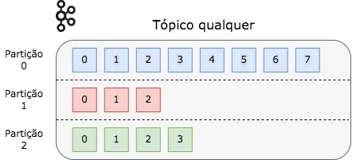
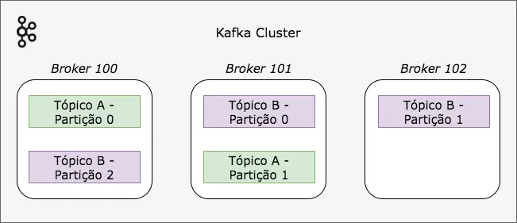
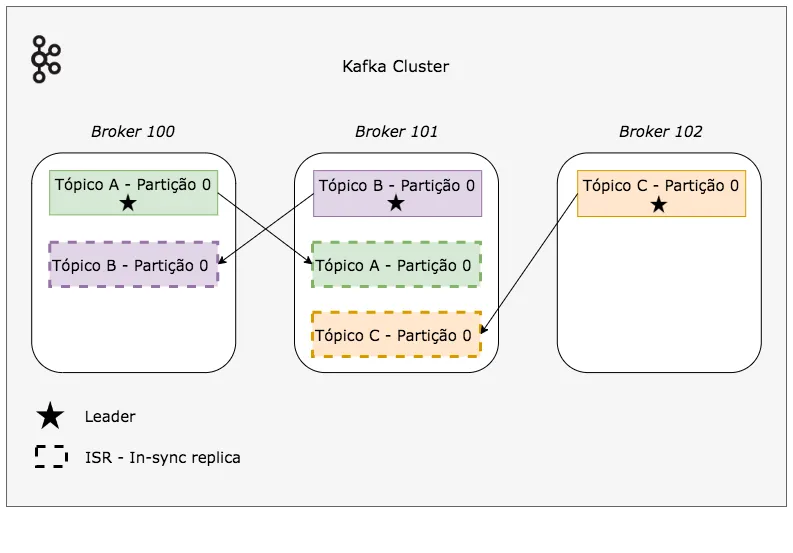
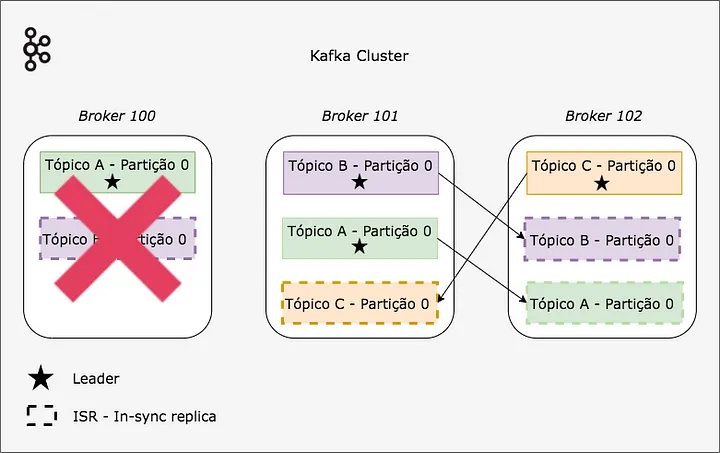
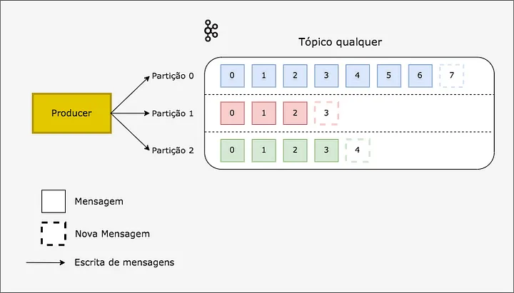
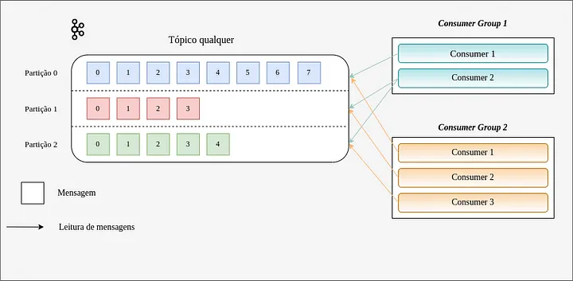
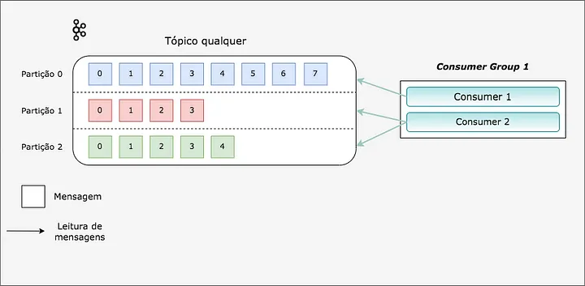
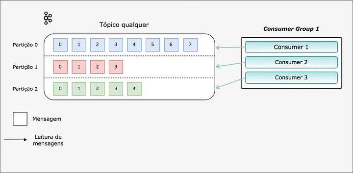
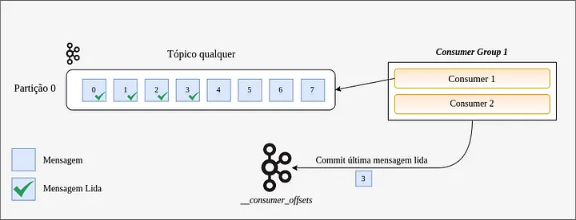
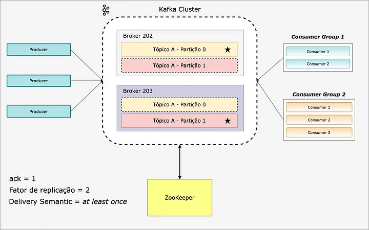

# Apache Kafka — The basics

## Introduction

The goal of this article is to cover all the basic theory of Kafka, from producing to consuming messages, in an objective and straightforward way, without leaving out some important details.

### What this article does not cover

Questions like:
- When should I use Kafka?
- How do I configure Kafka?
- How many brokers should I use?
- How do I create a Producer class in Java?

### What this article covers

- Topics and partitions
- Brokers and Clusters
- Replication factor
- Producers (acknowledgment, partition assignment by key)
- Consumers (consumer groups, delivery semantics, rebalancing)
- ZooKeeper

I hope you enjoy it!

## Topics and Partitions

The main element and the foundation of everything in the Kafka ecosystem. Topics are a way of categorizing messages.

Some characteristics of topics are:

- Similar to a table in a relational database, but without any constraints;
- Just as a database can have an unlimited number of tables, you can have an unlimited number of Kafka topics;
- Each topic is identified by its name, so two topics cannot have the same name.

 > Kafka topics are divided into partitions. Each partition is a division independent of the others within the topic, and each one is ordered.

Image 1 below illustrates how a Kafka topic with three partitions works. Partition 0 has eight messages, partition 1 has three and partition 2 has four.

As messages arrive at the partitions, they receive an incremental numeric ID called the offset, and they are read from beginning to end.

> There is no guarantee that messages will be read in order across the same topic, since __this guarantee only exists for messages within the same partition.__
>
> __Example__: In Partition 0, it is impossible for the message with ID 2 to be read before the message with ID 1. However, this guarantee does not apply across partitions.

Another characteristic of messages is immutability. This means that once a message is appended to a partition, its value can never be updated or deleted; in other words, the message will stay there until the configured retention time.

But where are topics stored?

## Brokers and Clusters

Kafka can run on one or more Clusters, which can be located in different datacenters or clouds. A Kafka Cluster is made up of a set of brokers.

You can think of it like this:

- Cluster = Machines
- Brokers = Servers.

Each broker is identified by a numeric ID and holds partitions of Kafka topics. Image 2 shows what a Cluster with two topics — A and B, with two and three partitions respectively — would look like.

But what if the number of partitions is greater than the number of brokers?

In that scenario, some brokers may hold more than one partition of the same topic. For example, imagine that a new topic (Topic C) with 4 partitions was created in the cluster from image 2. The split within the cluster would look like this:

__Topic C__
- Partition 0 -> Broker 100
- Partition 1 -> Broker 101
- Partitions 2 and 3 -> Broker 102 (two partitions on the same broker)

> Partitions are completely independent of the broker. There is no sequence, and it is not possible to predict which broker a partition will be assigned to.

### Topic Replication

As we saw, Kafka distributes topic partitions across brokers, but just distributing the partitions is not enough.

- If a broker goes down, what happens to the unread messages in the topics?
- Will the topics end up with fewer partitions?

Kafka was built to be distributed and fault tolerant. In the world of distributed computing, data redundancy is necessary. Kafka solves these problems through a process called the __topic replication__ factor.

And how does it work?

For each Kafka topic you must define the replication factor. This number should be greater than 1, but it is usually between 2 and 3 — 3 being the most recommended. With a replication factor of 2, for example, a topic will have its messages passively synchronized on two different brokers (image 3).

Besides the replication factor, there is the concept of Leader and Replicas (in some places they are called followers).

>The Leader is the partition responsible for receiving the data and sending it to the replicas; in other words, the Leader is the active partition receiving and serving data. The replicas live on the brokers other than the Leader's and only synchronize the data on each action of the Leader.

In image 3 you can see who the Leader is and who the replicas (followers) of each partition are:

> NOTE: Only one broker can be the leader of a given partition.
>
> E.g.: It is not possible to have, at the same time, a leader for partition 0 on broker 100 and on broker 101.
> Therefore, a partition has one Leader and multiple Replicas (ISR — In sync replica).

Here is the list of Leaders and Replicas for each partition, based on Image 3:

__Topic A (Partition 0)__

- Leader -> Broker 100;
- Replica -> Broker 101

__Topic B (Partition 0)__

- Leader -> Broker 101;
- Replica -> Broker 100

__Topic C (Partition 0)__

- Leader -> Broker 102;
- Replica -> Broker 101

But what would happen if Broker 100 died?

Topic A (Partition 0) would have its leader moved to Broker 101, and a replica would be created on Broker 102. Topic B (Partition 0), which had a replica on Broker 100, will have a new replica created on Broker 102. Image 4 shows this shift.

If Broker 100 comes back online, Topic A (partition 0) may become Leader again.

This is how Kafka guarantees data integrity and availability!

## Producers

A Producer's responsibility is to __write or publish messages__ (data) to Kafka topics — since topics are made of partitions, the data is, logically, stored in partitions.

You always need to tell the Producer which topic it will write messages to. When you do that, Kafka automatically decides which partition the message will be sent to (Image 5).

When a message is sent by the Producer, __it is not possible to know which partition will hold the message__. However, there are two basic cases that determine the path of a given message.

__Case 1: key != null__

A key can be literally anything — a string, an integer, a timestamp. When messages are sent with the same key, it is guaranteed that they will always land in the same partition. You can't know which one, but it will always be the same.

__Case 2: key == null__

If no key is provided when producing messages, Kafka will distribute the messages across partitions using the [Round-Robin](https://en.wikipedia.org/wiki/Round-robin_scheduling) algorithm.

### Ack (Acknowledgment)
When Producers write messages to topics, they receive an acknowledgment that the messages were synchronized by the partitions and replicas. The level of acknowledgment can vary depending on the configured ack level. There are three main ack levels:

- __acks = 0__

At this level the Producer __does not wait for any acknowledgment__ from the broker and will always assume the messages arrived successfully. If a message does not reach the broker, it will be lost.

Although this approach looks dangerous — and it really is — it guarantees high throughput.

- __acks = 1 (Default)__

The Producer will assume the message arrived successfully __when the broker holding the Leader partition receives the message.__ If the message does not reach the Leader, an error is raised and the Producer can retry the message later.

However, the message can still be lost if the Leader dies before the messages reach the replicas.

- __acks = all__

The Producer will assume the message arrived successfully __when the Leader and all replicas (in-sync replicas) of the partition receive the message__. This is the safest mode, but at the same time it has the highest latency.

## Consumers

Consumers are responsible for __reading messages from a topic__. A Consumer can be a Java application, for example.

In the same way that Producers publish messages to a topic, Consumers subscribe to topics to consume/read the messages. You can draw an analogy with the publish/subscribe pattern.

Reading always happens in the order in which messages were produced, as long as the reading happens within the same partition.

> Just as several Producers can write/publish messages to a given partition, several Consumers can read messages from a given partition.

Consumers usually consume messages in groups. To coordinate this consumption there is a concept called Consumer Groups.

### Consumer Groups

Consumer Groups represent a set of Consumers.

When several Consumers in the same Consumer Group subscribe to a topic, each Consumer will read messages from a specific subset of partitions.

Image 6 shows a model of message consumption through two different Consumer Groups.

The number of partitions each Consumer Group consumes is directly related to the number of consumers. Kafka does its best to balance the distribution across consumers.

The rule is as follows (use image 6 as a reference):

- __If number of consumers = number of partitions__: Each consumer consumes from a different partition. E.g.: Consumer Group 2 in image 6

- __If number of consumers < number of partitions__: Kafka will balance, but some consumers will read data from more than one partition. E.g.: Consumer Group 1 has two consumers to read messages from three partitions, so Consumer 2 became responsible for reading the messages from partitions 1 and 2.

- __If number of consumers > number of partitions__: Each consumer will read data from only one partition; the remaining ones will stay inactive (IDLE).

> The strategy of creating more consumers than partitions is valid, even with the side effect of some consumers staying idle, because a broker might go down/die. That way the idle consumers take the place of the ones that went down and the consumption rate does not drop.

According to image 6, we have two Consumer Groups. Imagine that Consumer Group 1 is a Java application, and Consumer Group 2 is another application written in Python for data analysis work.

> Both Consumer Groups will consume all messages from the topic. This means that every message consumed by Consumer Group 1 will also be consumed by Consumer Group 2

This strategy of using consumer groups makes the data produced in these topics available for several use cases within the same organization.

And what if a new application needs to consume the data from this *Arbitrary Topic*? In that case, the new application just needs to create a new Consumer Group and subscribe to the topic.

### Rebalancing

Imagine a scenario where a given Kafka topic has three partitions and two consumers.

Image 7 shows what the Consumer/Partition distribution for this topic might look like.

*Consumer 1* is assigned to Partition 0, while Consumer 2 is assigned to Partitions 1 and 2.

But what would happen if a new consumer were added to the Consumer Group? And if *Consumer 2* died, would the partitions assigned to it be left without a consumer?

In both cases above, Kafka will trigger the topic __rebalancing__ system.

> Rebalancing means assigning the set of active consumers to a new subset of partitions

Image 8 simulates, in a very simple way, rebalancing when the Consumer Group gets one more Consumer. In this context, each consumer is now assigned to a single partition.

Notice that before, Consumer 2 was assigned to Partitions 1 and 2, but after rebalancing, Consumer 3 became assigned to Partition 2.

This situation raises an interesting question.

Imagine that Partition 2 has ten messages and, before rebalancing, Consumer 2 consumed five of them. After rebalancing, how does the new Consumer 3 know that it should start consuming from the sixth message?

The answer is called Consumer Offsets.

### Consumer Offsets

Consumer offsets are a way of tracking the offset of the last message consumed by a given Consumer Group.

> The Consumer Offsets mechanism lets Kafka resume consuming messages from the last committed offset, without having to consume all messages from the beginning.

Image 9 shows the Consumer Offsets mechanism. As messages are read by Consumer 1, the Kafka Broker periodically sends a message to a special topic called __consumer_offsets with the last offset read from the partition.

That way, even if rebalancing happens, the new consumers assigned to the topics will know exactly which offset to start consuming messages from.

### Delivery Semantics

As we saw in the section about Producers, different acknowledgment levels can be configured for sending messages.

Alongside that, delivery semantics is a way of configuring when a message will be committed to the **__consumer_offsets** topic; in other words, it defines when a message can be considered processed.

> Rebalancing is an event that happens frequently in Kafka. That is why Delivery Semantics is such an important topic.

There are three main strategies for manual delivery (manual commit) of offsets:

- __At least once (default)__
With this option, offsets are committed as soon as the messages are processed. If processing fails, the message will be read again. This guarantees that no message will be lost.

This option can lead to duplicate reads (at least once). That is why it is important to implement idempotency mechanisms.

- __At most once__
Offsets are committed as soon as the messages arrive, but there is no guarantee that these messages will be processed correctly. There is a risk of losing messages.

With this setting, the preference is for no message to arrive rather than for it to arrive duplicated.

- __Exactly once__
Guarantees that all messages will be processed correctly and only once. This strategy uses an idempotent consumer plus the Transaction API to work.

> Exactly once is a relatively new (and controversial!) and somewhat deeper topic in Kafka. It will not be covered in this article, but it is worth looking into if you are curious.

### Zookeeper

"Zookeeper is a centralized service for maintaining configuration information, naming, providing distributed synchronization, and providing group services".

In the context of Kafka, the Zookeeper software is responsible for storing metadata about the brokers, for example:

- Zookeeper keeps a list of the brokers in a cluster.
- It helps in the process of electing a partition leader
- It sends notifications to Kafka when a new topic is created, when a broker dies, when a broker comes up, etc…

> Zookeeper will no longer work with Kafka starting from version 4.x. For more details, look up Kafka Raft (KIP-500).

## Overall Architecture
Image 10 represents all the concepts in this article: brokers, clusters, partitions, producers, consumers and Zookeeper. Together, these concepts make up Kafka's overall architecture.

## References

- Saphira, Gwen, et al. Kafka: The Definitive Guide 2nd Edition
- [Kafka Docs](https://kafka.apache.org/documentation/).
- [Zookeeper Docs](https://zookeeper.apache.org/).
