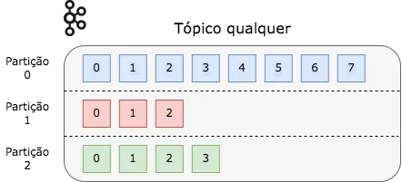
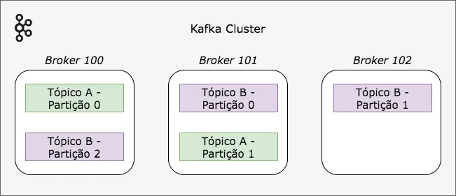
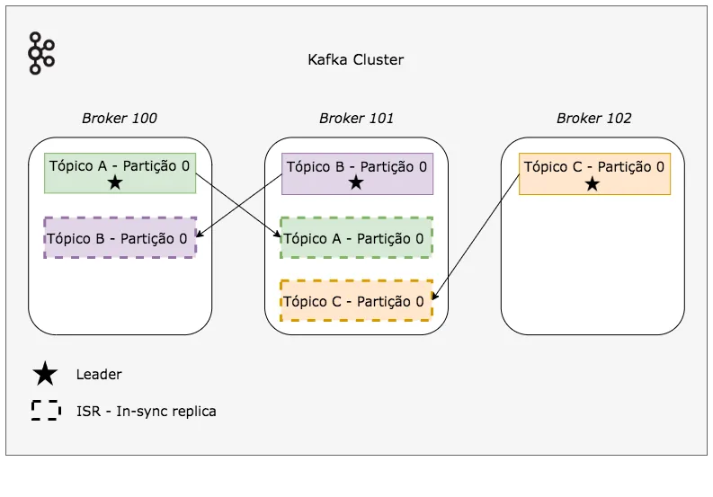
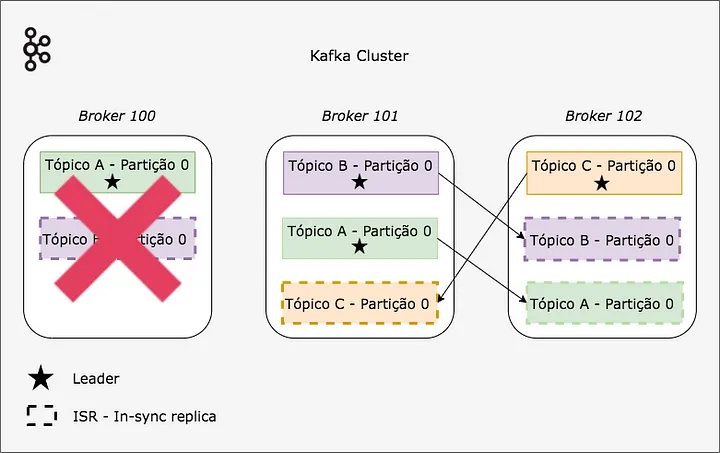
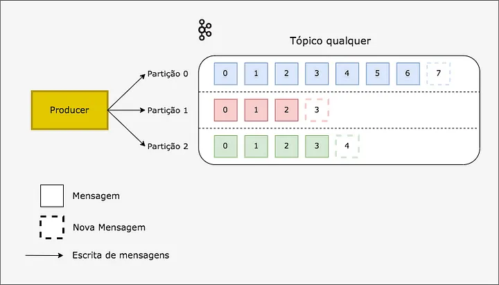
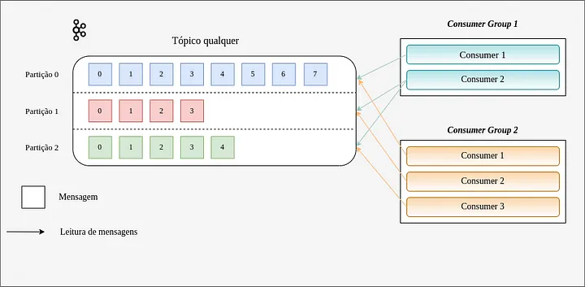
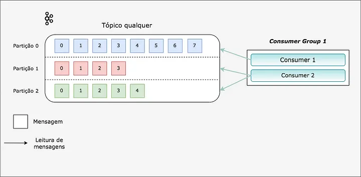
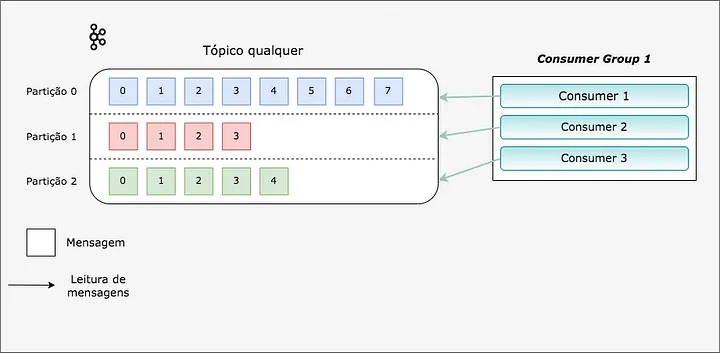
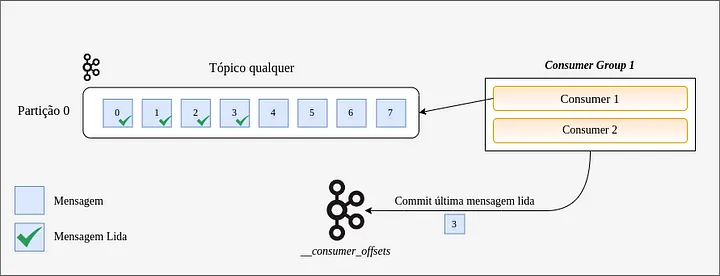
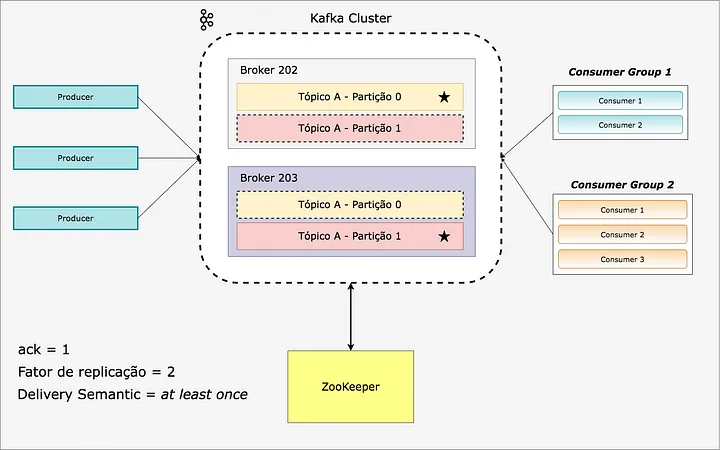

# Apache Kafka — Lo básico

## Introducción

La idea de este artículo es cubrir toda la teoría básica de Kafka, desde la producción hasta el consumo de mensajes, de manera objetiva y directa, sin dejar de lado algunos detalles importantes.

### ¿Qué no cubre este artículo?

Preguntas como:
- ¿Cuándo debo usar Kafka?
- ¿Cómo configuro Kafka?
- ¿Cuántos brokers debo usar?
- ¿Cómo creo una clase Producer en Java?

### ¿Qué cubre este artículo?

- Tópicos y particiones
- Brokers y Clusters
- Factor de replicación
- Producers (acknowledgment, asignación de partición por key)
- Consumers (consumer groups, delivery semantics, rebalanceo)
- ZooKeeper

¡Espero que les guste!

## Tópicos y Particiones

El elemento principal y la base de todo dentro del ecosistema de Kafka. Los tópicos son una forma de categorizar mensajes.

Algunas características de los tópicos son:

- Son similares a una tabla de una base de datos relacional, pero sin ninguna constraint;
- Así como en una base de datos se pueden tener infinitas tablas, es posible tener infinitos tópicos de Kafka;
- Cada tópico se identifica por su nombre, por lo tanto, no es posible que dos tópicos tengan el mismo nombre.

 > Los tópicos de Kafka se dividen en particiones. Cada partición es una división independiente de las demás dentro del tópico, y cada una está ordenada.

La imagen 1, a continuación, ilustra el funcionamiento de un tópico de Kafka con tres particiones. La partición 0 tiene ocho mensajes, la partición 1 tiene tres y la partición 2 tiene cuatro.

A medida que los mensajes llegan a las particiones, reciben un ID numérico incremental llamado offset y se leen del principio al final.

> No hay garantía de que la lectura ordenada de mensajes funcione dentro del mismo tópico, ya que __esa garantía existe solo para mensajes dentro de la misma partición.__
>
> __Ejemplo__: Es imposible que en la Partición 0 el mensaje con ID 2 se lea antes que el mensaje con ID 1. Sin embargo, esa garantía no se aplica entre particiones.

Otra característica de los mensajes es la inmutabilidad. Esto significa que, una vez que el mensaje se agrega a una partición, su valor nunca podrá actualizarse ni eliminarse; es decir, el mensaje permanecerá allí hasta el tiempo de retención configurado.

Pero, ¿dónde se almacenan los tópicos?

## Brokers y Clusters

Kafka puede ejecutarse en uno o más Clusters, que pueden estar ubicados en distintos datacenters o clouds. Un Cluster de Kafka está compuesto por un conjunto de brokers.

Se puede pensar así:

- Cluster = Máquinas
- Brokers = Servidores.

Cada broker se identifica por un ID numérico y contiene particiones de tópicos de Kafka. La imagen 2 ejemplifica cómo sería un Cluster con dos tópicos — A y B, con dos y tres particiones, respectivamente.

Pero, ¿y si el número de particiones es mayor que el número de brokers?

En ese escenario, algunos brokers podrán contener más de una partición de un mismo tópico. Por ejemplo, imagina que se creó un nuevo tópico (Tópico C) con 4 particiones dentro del cluster de la imagen 2. La división dentro del cluster quedaría así:

__Tópico C__
- Partición 0 -> Broker 100
- Partición 1 -> Broker 101
- Particiones 2 y 3 -> Broker 102 (dos particiones en el mismo broker)

> Las particiones son completamente independientes del broker. No existe una secuencia, ni es posible prever a qué broker se asignará una partición.

### Replicación de Tópicos

Como vimos, Kafka distribuye las particiones de los tópicos entre los brokers, pero solo distribuir las particiones no es suficiente.

- Si un broker se cae, ¿qué pasará con los mensajes de los tópicos que no se han leído?
- ¿Los tópicos quedarán con menos particiones?

Kafka fue creado para ser distribuido y tolerante a fallos. En el universo de la computación distribuida es necesario que exista redundancia de datos. Kafka, por su parte, resuelve estos problemas mediante un proceso llamado factor de __replicación de tópicos.__

¿Y cómo funciona?

Para cada tópico de Kafka se debe definir el factor de replicación. Este número debe ser mayor que 1, pero generalmente está entre 2 y 3 — siendo 3 el más recomendado. Con un factor de replicación 2, por ejemplo, un tópico tendrá sus mensajes sincronizados de forma pasiva en dos brokers diferentes (imagen 3).

Además del factor de replicación, existe el concepto de Leader y Replicas (en algunos lugares se les llama followers).

>El Leader es la partición responsable de recibir los datos y enviarlos a las réplicas; es decir, el Leader representa la partición activa que recibe y sirve datos. Las réplicas se ubican en los demás brokers distintos al del Leader y solo sincronizan los datos con cada acción del Leader.

En la imagen 3 se puede identificar quién es el Leader y quiénes son las réplicas (followers) de cada partición:

> NOTA: Solo un único broker puede ser el líder de una partición determinada.
>
> Ej.: No es posible que exista, al mismo tiempo, un líder para la partición 0 en el broker 100 y en el broker 101.
> Por lo tanto, una partición tiene un Leader y múltiples Replicas (ISR — In sync replica).

A continuación, la lista de Leaders y Replicas de cada partición tomando como base la Imagen 3:

__Tópico A (Partición 0)__

- Leader -> Broker 100;
- Replica -> Broker 101

__Tópico B (Partición 0)__

- Leader -> Broker 101;
- Replica -> Broker 100

__Tópico C (Partición 0)__

- Leader -> Broker 102;
- Replica -> Broker 101

Pero, ¿qué pasaría si el Broker 100 muriera?

El Tópico A (Partición 0) tendría su líder desplazado al Broker 101 y se crearía una réplica en el Broker 102. El Tópico B (Partición 0), que tenía una réplica en el Broker 100, tendrá una nueva réplica creada en el Broker 102. La imagen 4 muestra este desplazamiento.

Si el Broker 100 vuelve a funcionar, el Tópico A (partición 0) podrá volver a ser Leader.

¡Así es como Kafka garantiza la integridad y la disponibilidad de los datos!

## Producers

La responsabilidad de un Producer es __escribir o publicar mensajes__ (datos) en los tópicos de Kafka — como los tópicos están formados por particiones, lógicamente, los datos quedan almacenados en particiones.

Siempre es necesario indicar en qué tópico escribirá los mensajes el Producer. Al hacerlo, Kafka automáticamente definirá a qué partición se enviará el mensaje (Imagen 5).

Cuando el Producer envía un mensaje, __no es posible saber qué partición retendrá el mensaje__. Sin embargo, existen dos casos básicos que definirán el camino de un mensaje determinado.

__Caso 1: key != null__

Una key puede ser literalmente cualquier cosa — un string, un entero, un timestamp. Cuando se envían mensajes con la misma key, se garantiza que siempre caerán en la misma partición. No es posible saber cuál, pero siempre será la misma.

__Caso 2: key == null__

Si no se informa ninguna key al producir mensajes, Kafka distribuirá los mensajes entre las particiones usando el algoritmo [Round-Robin](https://es.wikipedia.org/wiki/Planificaci%C3%B3n_Round-robin).

### Ack (Acknowledgment)
Cuando los Producers escriben mensajes en los tópicos, reciben una confirmación (en inglés, acknowledgment) de que los mensajes fueron sincronizados por las particiones y réplicas. El nivel de confirmación puede variar según el nivel de ack configurado. Hay tres niveles principales de ack:

- __acks = 0__

En este nivel el Producer __no espera ninguna confirmación__ del broker y siempre asumirá que los mensajes llegaron con éxito. Si el mensaje no llega al broker, se perderá.

Aunque este enfoque parezca peligroso — y realmente lo es —, garantiza un alto throughput.

- __acks = 1 (Predeterminado)__

El Producer asumirá que el mensaje llegó con éxito __cuando el broker que contiene la partición Leader reciba el mensaje.__ Si el mensaje no llega al Leader, se generará un error y el Producer podrá hacer retry del mensaje más tarde.

Sin embargo, el mensaje aún podrá perderse si el Leader muere y los mensajes no han llegado a las réplicas.

- __acks = all__

El Producer asumirá que el mensaje llegó con éxito __cuando el Leader y todas las réplicas (in-sync replicas) de la partición reciban el mensaje__. Este es el modo más seguro, pero, al mismo tiempo, es el de mayor latencia.

## Consumers

Los Consumers son responsables de la __lectura de mensajes de un tópico__. Un Consumer puede ser una aplicación Java, por ejemplo.

De la misma forma que los Producers publican (publish) los mensajes en un tópico, los Consumers se suscriben (subscribe) a los tópicos para consumir/leer los mensajes. Se puede pensar en una analogía con el patrón publish/subscribe.

La lectura siempre se hace en el orden en que se producen los mensajes, siempre que la lectura ocurra dentro de la misma partición.

> Así como es posible que varios Producers escriban/publiquen mensajes en una partición determinada, varios Consumers pueden leer mensajes de una partición determinada.

Generalmente los Consumers consumen los mensajes en grupos. Para coordinar este consumo existe un concepto llamado Consumer Groups.

### Consumer Groups

Los Consumer Groups representan un conjunto de Consumers.

Cuando varios Consumers de un mismo Consumer Group se suscriben a un tópico, cada Consumer leerá los mensajes de un subconjunto específico de particiones.

La imagen 6 presenta un modelo de consumo de mensajes a través de dos Consumer Groups diferentes.

La cantidad de particiones que consume cada Consumer Group está directamente relacionada con la cantidad de consumidores. Kafka hace lo posible por balancear la distribución entre cada consumidor.

La regla es la siguiente (usa la imagen 6 como referencia):

- __Si número de consumidores = número de particiones__: Cada consumidor consume de una partición diferente. Ej.: El Consumer Group 2 de la imagen 6

- __Si número de consumidores < número de particiones__: Kafka balanceará, pero algunos consumidores leerán datos de más de una partición. Ej.: El Consumer Group 1 tiene dos consumers para leer mensajes de tres particiones, por lo tanto, el Consumer 2 quedó responsable de leer los mensajes de las particiones 1 y 2.

- __Si número de consumidores > número de particiones__: Cada consumidor leerá los datos de una sola partición; los que sobren quedarán en estado inactivo (IDLE).

> La estrategia de crear más consumidores que particiones es válida, incluso con el efecto secundario de que algunos consumidores queden inactivos, porque puede pasar que algún broker se caiga/muera. De esta forma, los consumidores inactivos toman el lugar de los que cayeron y la frecuencia de consumo no disminuye.

Según la imagen 6, tenemos dos Consumer Groups. Imagina que el Consumer Group 1 es una aplicación Java, y el Consumer Group 2 es otra aplicación hecha en Python para trabajos de análisis de datos.

> Ambos Consumer Groups consumirán todos los mensajes del tópico. Esto significa que todos los mensajes que consuma el Consumer Group 1 también los consumirá el Consumer Group 2

Esta estrategia de usar grupos de consumidores permite que los datos producidos en estos tópicos estén disponibles para varios casos dentro de la misma organización.

¿Y si una nueva aplicación necesita consumir los datos de este *Tópico Cualquiera*? En ese caso, basta con que la nueva aplicación cree un nuevo Consumer Group y se suscriba al tópico.

### Rebalanceo

Imagina un escenario en el que un tópico de Kafka determinado tiene tres particiones y dos consumidores.

La Imagen 7 muestra cómo podría quedar la distribución entre Consumers/Particiones para este tópico.

El *Consumer 1* está asociado a la Partición 0, mientras que el Consumer 2 está asociado a las Particiones 1 y 2.

Pero, ¿qué pasaría si se incluyera un nuevo consumidor en el Consumer Group? ¿Y si *el Consumer 2* muriera, las particiones asociadas a él quedarían sin consumidor?

En los dos casos citados arriba, Kafka activará el sistema de __rebalanceo__ de tópicos.

> Rebalancear implica asociar el conjunto de consumidores activos a un nuevo subconjunto de particiones

La imagen 8 simula, de manera muy simple, el rebalanceo en la hipótesis de que el Consumer Group reciba un Consumidor más. En este contexto, ahora cada consumidor está asociado a una única partición.

Observa que antes el Consumer 2 estaba asociado a las Particiones 1 y 2, pero, después del rebalanceo, el Consumer 3 pasó a estar asociado a la Partición 2.

Con esta situación surge una pregunta interesante.

Imagina que la Partición 2 tiene diez mensajes y, antes del rebalanceo, el Consumer 2 consumió cinco mensajes. Después del rebalanceo, ¿cómo sabe el nuevo Consumer 3 que debe consumir a partir del sexto mensaje?

La respuesta a esto se llama Consumer Offsets.

### Consumer Offsets

Los consumer offsets son una forma de rastrear cuál fue el offset del último mensaje consumido por un Consumer Group determinado.

> El mecanismo de Consumer Offsets permite a Kafka continuar el consumo de mensajes a partir del último offset commiteado, sin necesidad de consumir todos los mensajes desde el inicio.

La imagen 9 muestra el mecanismo de Consumer Offsets. A medida que el Consumer 1 lee los mensajes, el Broker de Kafka envía periódicamente un mensaje a un tópico especial llamado __consumer_offsets informando el último offset leído de la partición.

De esta manera, aunque haya rebalanceo, los nuevos consumidores asociados a los tópicos sabrán exactamente a partir de qué offset deben comenzar a consumir los mensajes.

### Delivery Semantics

Como se vio en la parte sobre Producers, se pueden configurar distintos niveles de acknowledgment para el envío de mensajes.

En paralelo a esto, delivery semantics es una forma de configurar cuándo se hará commit del mensaje en el tópico **__consumer_offsets**, es decir, es la definición de cuándo un mensaje podrá clasificarse como procesado.

> El rebalanceo es un evento que ocurre con frecuencia en Kafka. Por eso el tema de Delivery Semantics es tan importante.

Existen tres estrategias principales de delivery manual (commit manual) de los offsets:

- __At least once (predeterminado)__
En esta opción, se hace commit de los offsets en cuanto se procesan los mensajes. Si ocurre un fallo en el procesamiento, el mensaje se leerá de nuevo. Esto garantiza que ningún mensaje se perderá.

Esta opción puede provocar lecturas duplicadas (at least once). Por eso es importante implementar mecanismos de idempotencia.

- __At most once__
Se hace commit de los offsets en cuanto llegan los mensajes, pero no hay garantía de que esos mensajes se procesen correctamente. Hay riesgo de pérdida de mensajes.

Con esta configuración, la preferencia es que no llegue ningún mensaje antes que llegue duplicado.

- __Exactly once__
Garantiza que todos los mensajes se procesarán correctamente y una sola vez. Esta estrategia usa un consumidor idempotente más la Transaction API para funcionar.

> Exactly once es un tema relativamente nuevo (¡y polémico!) dentro de Kafka y un poco más profundo. No se abordará en este artículo, pero vale la pena investigarlo si te da curiosidad.

### Zookeeper

"Zookeeper es un servicio centralizado que guarda información sobre configuraciones, nombres, provee sincronización distribuida y grupos de servicio".

En el contexto de Kafka, el software Zookeeper es responsable de guardar metadatos sobre los brokers, por ejemplo:

- Zookeeper mantiene una lista de los brokers dentro de un cluster.
- Ayuda en el proceso de elección de un líder de partición
- Envía notificaciones a Kafka cuando se crea un nuevo tópico, cuando un broker muere, cuando un broker se levanta, etc…

> Zookeeper no funcionará junto con Kafka a partir de la versión 4.x. Para más detalles, busca sobre Kafka Raft (KIP-500).

## Arquitectura General
La imagen 10 representa todos los conceptos de este artículo: brokers, clusters, particiones, producers, consumers y Zookeeper. En conjunto, estos conceptos forman la arquitectura general de Kafka.

## Referencias

- Saphira, Gwen, et al. Kafka: The Definitive Guide 2nd Edition
- [Kafka Docs](https://kafka.apache.org/documentation/).
- [Zookeeper Docs](https://zookeeper.apache.org/).
