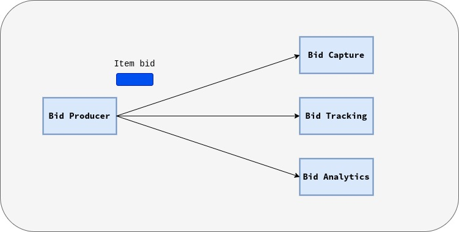
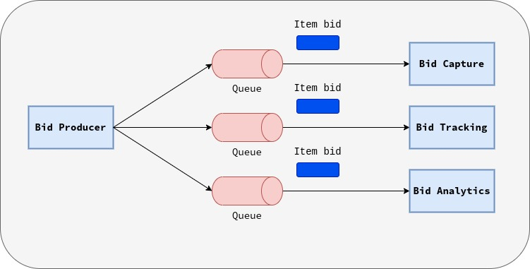

> Chapter two introduces the first part of the book: __Foundations__

# Chapter 2 - Architectural Thinking

In this chapter, the author lists four aspects needed to develop architectural thinking:

- 1. Understanding the difference between architecture and design

- 2. Breadth vs depth of knowledge

- 3. Understanding and analyzing trade-offs

- 4. Understanding the _business drivers_ and translating them into the architecture

Each aspect is explored in more detail below.

## Architecture vs Design

Here are the differences between the architect's responsibilities - the architecture - and the developer's responsibilities - the design of the application code.

The architect is responsible for:

> - Analyzing the business requirements and, from them, defining the architectural characteristics ("ilities").
>
> - Defining the architectural pattern and the design principles.
>
> - Creating components or building blocks of the system.

While the developer is responsible for:

> - Creating the user interfaces (or screens) of the application.
>
> - Developing and testing the source code.
>
> - Creating class diagrams (I consider this a VERY QUESTIONABLE responsibility, but that's how the author puts it).

The author argues that the big issue is that, in traditional development models, communication between the architect and the development team happened **one way**, creating a disconnect. Some decisions the architect made were not applied by the development team, while decisions the development team made that changed the architecture were not passed on to the architect.

The solution, therefore, is constant feedback and **two-way**, open and receptive communication between the architect and the development team. This lets the architect come down from their lofty throne (ahem...) and become part of the team, mentoring the developers.

Notice the clear contrast between the two approaches. One is static, similar to the waterfall development model; the other is iterative, embraces change, agile, as it should be.

The author concludes with the following question:

> _So when does architecture end and software design begin?_
>
> A: It doesn't. Both are part of the development cycle and must be in sync.

## Technical Breadth

Technical knowledge can be divided into a three-level pyramid, from bottom to top:

- Stuff you don't know you don't know.

- Stuff you know you don't know.

- Stuff you know.

When starting out in a development career, the ideal is to try to expand the top of the pyramid (stuff you know). That way the programmer gains experience and knowledge, that is: _Technical Depth_.

Over time, as the developer evolves and reaches the architect role, their focus should change. Now they should seek a balance between the top and the middle of the pyramid. **For an architect, breadth is more important than depth**. It's better for them to know the trade-offs of 10 different caching tools than to be an expert in just one.

This means the architect may give up some of the skills they acquired during the early stages as a developer - getting rusty, so to speak. Not only the architect, but every developer should weigh the balance between expertise and depth throughout their career. You need to know which battles to fight.

## Analyzing trade-offs

According to the author, thinking like an architect means seeing the trade-offs in every solution. Unlike developers, who tend to see only the benefits of a given solution, architects need to see both sides of the coin.

So if someone asks which is better: Topics or Queues?

The answer: **It depends**. Here's why.

The author proposes an exercise based on an auction application with 4 components: Bid Producer, Bid Capture, Bid Tracking, Bid Analytics.

As we can see in figure 1, the Bid Producer produces a Bid that is sent to three services: Capture, Tracking and Analytics.

This can be done in two ways, using queues or topics, as shown in the following images.

### Topics

")

#### Advantages

The obvious advantage of topics is **extensibility**. If a new service - such as _Bid History_ - needs to listen to the bids, it just has to subscribe to the topic and nothing else in the system needs to change. It decouples the service that produces from the ones that listen to it.

#### Disadvantages

The disadvantages, however, are not so obvious, which is why the architect's job is so important. One point to consider is that any service can access the auction data (Item Bid) without the Producer knowing, creating a security gap in the application.

Another point, and the most interesting one in my opinion, is that a topic-based system using pub/sub has a homogeneous contract. All services that subscribe to the topic must accept the same message contract. If a specific service needs additional information the others don't need, all services will be affected by the contract change.

### Queues

#### Advantages

Right away you can see that, unlike the topic model (pub/sub), queues allow heterogeneous contracts between the different services consuming the messages. Another factor is the ability to scale services independently, through a Load Balancer associated with each queue.

Finally, queues have fewer security gaps, since they depend on a specific association between a Producer -> Queue -> Consumer.

#### Disadvantages

High coupling: each new consumer requires a new queue and, therefore, it is not very extensible.

---------------------------------------------------------------------------

The example made it clear that everything in software architecture is a trade-off. An architect analyzes each aspect discussed above, using the architectural thinking requirements mentioned earlier as parameters.

If someone asks: which one should I use, queues or topics? The answer is: __It depends!__

### Hands-on Coding

In the last part of the chapter, the author looks at the difficulties an architect faces in keeping a balance between software architecture and coding.

Losing the habit of writing code is not healthy. At the same time, a terrible bottleneck is created if the architect becomes the "owner" of the team's code. This often happens when the architect takes on the most complex tasks of the project - which most of the time are the ones that go beyond the framework currently in use.

The author presents five ways the architect can continuously stay hands-on without hurting the team:

- Building POCs (proofs of concept).

- Working on technical debt and leaving the most critical features to the team.

- Working on bug fixes.

- Building command-line tools to help the team's development process.

- Doing code reviews frequently.

## Next article in the series

*Article and reading still in progress... The link will show up here soon. Thanks*
