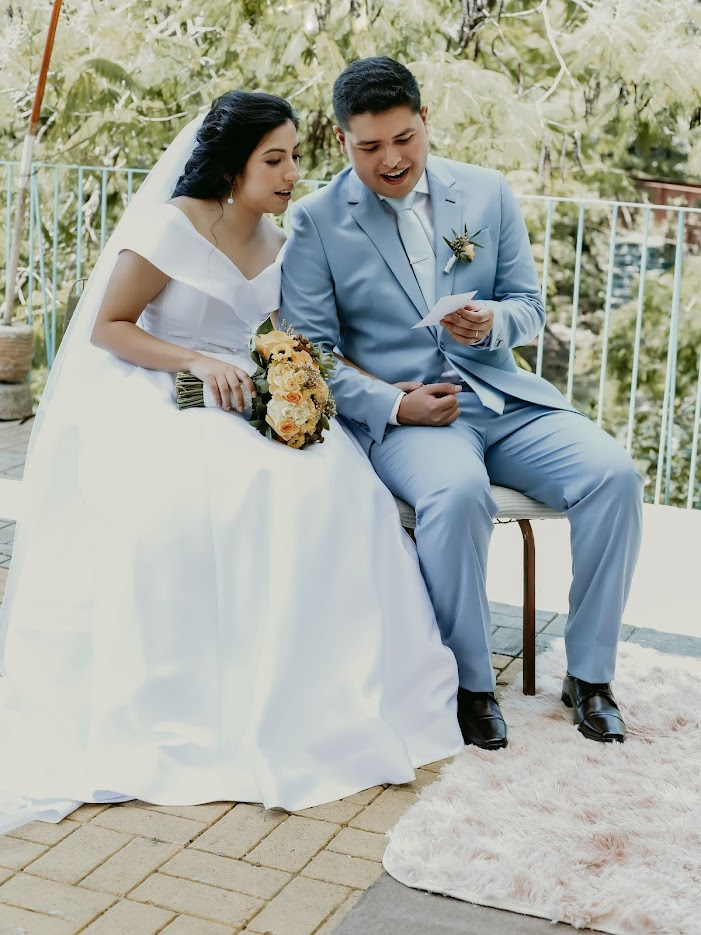
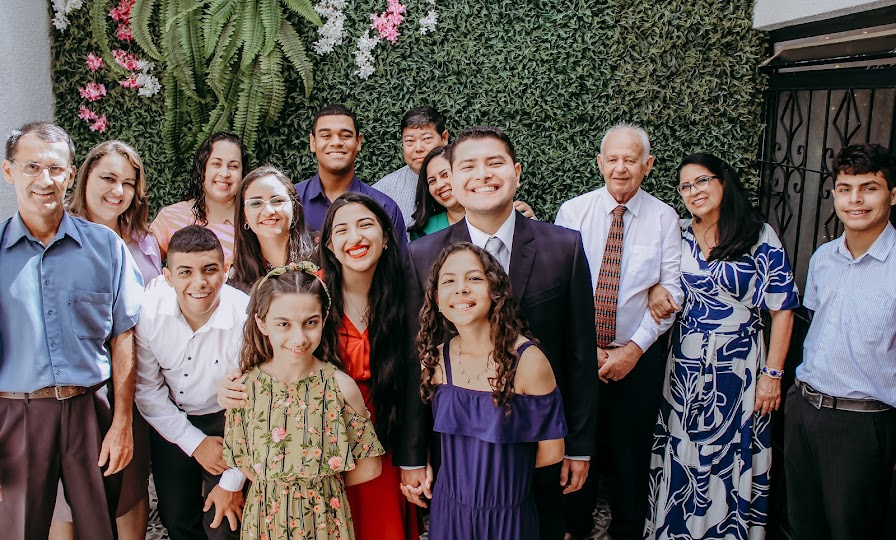
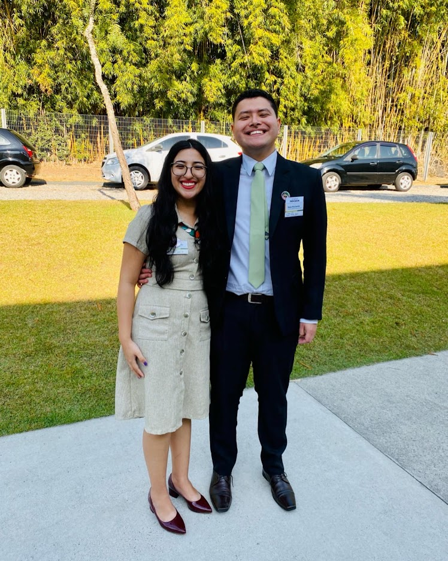
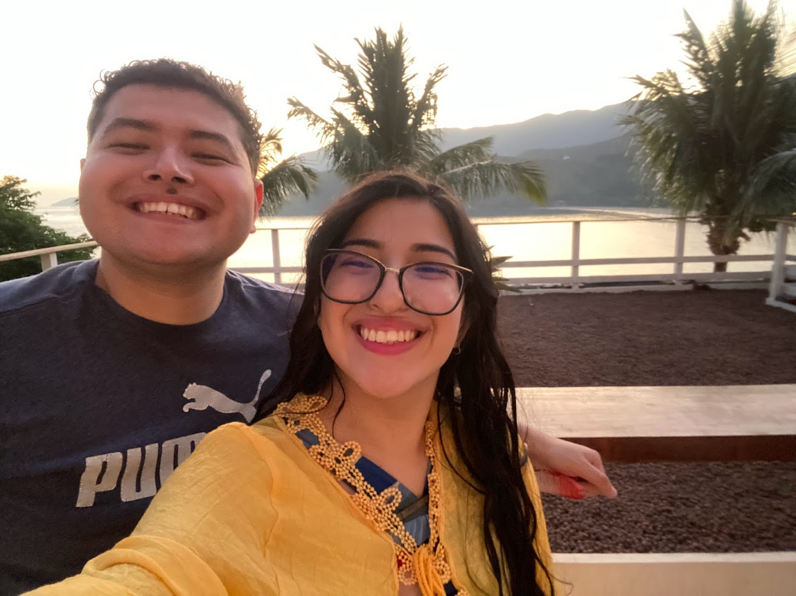
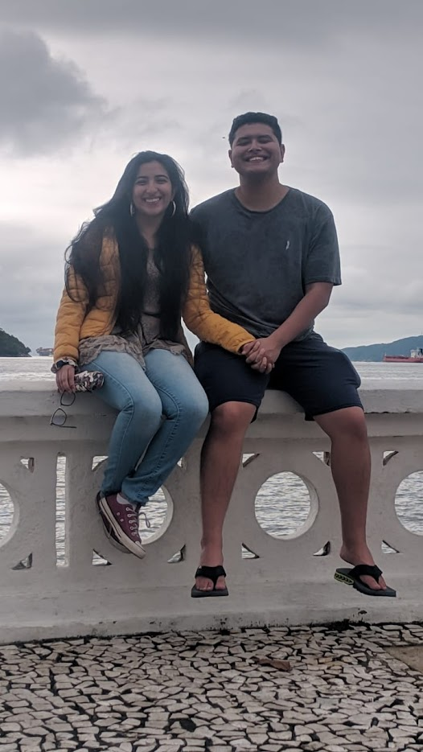
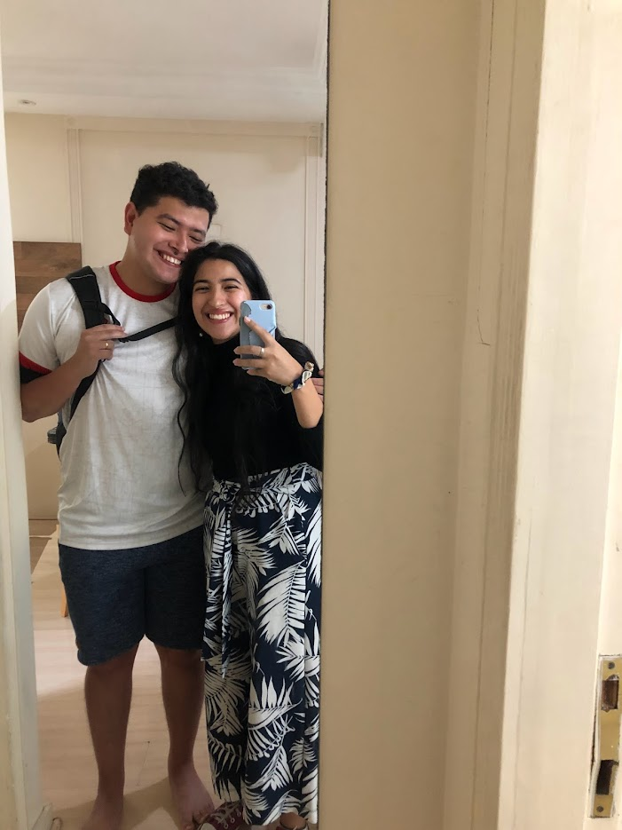
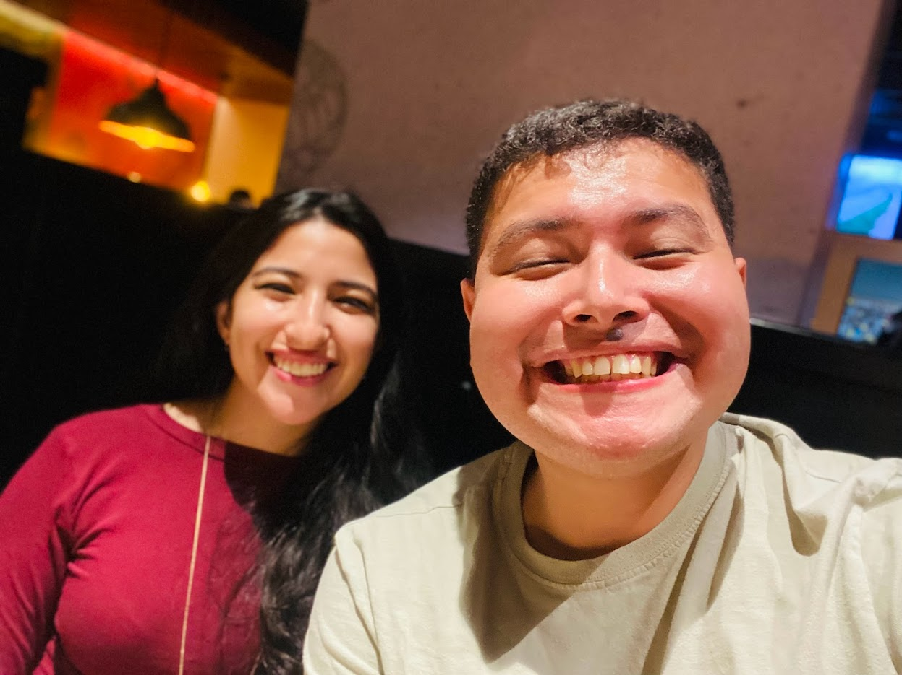
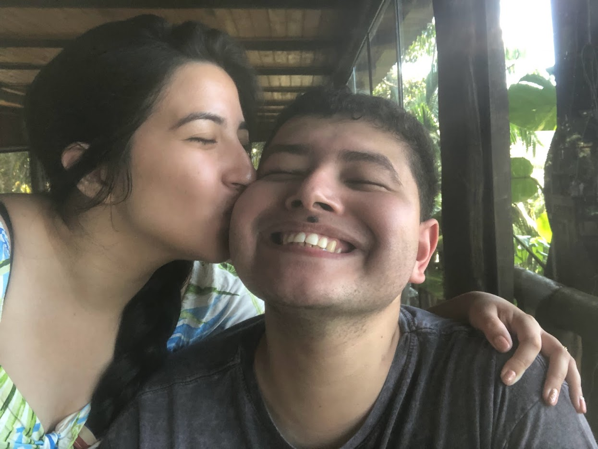

## Our first year together

Today is November 17, 2023, exactly 2:48 in the morning. This was the only time I could find to have this conversation with you. Maybe you're worried about me while I write this.

It's natural. You've always worried about me, haven't you? From the very first messages back in college asking me to get more sleep, to bigger things, like leaving your job to spend more time with me.

It's strange, because at the same time that I feel time flew by, I have the impression it took a long time, given everything we went through.

Some things were happy, others... not so much. But that's life, isn't it? Maybe when I'm writing a post on my blog celebrating our twenty-fifth year together, we'll understand that life's hardships made us stronger, closer... happier.

Want to relive these moments with me?

### Wedding day

It was the song, remember?

> "Let's write
>
> Our love story.
>
> Together, we will serve God.
>
> We will keep our vows.
>
> And, on the road of life,
>
> May you always be my love."

I like this part.

We are writing a "love story" and, at the same time, we are running along the road of life.

That road can sometimes be rough; there may be obstacles and other things that get in the way of our pursuit of life - the real life.

What matters is that, even in this first year, when we may have faced big obstacles, I never felt like I was running alone. And more than that, even when I fell, you were by my side and lifted me up.

This brings to mind a verse that makes me think of you...

> **1 Corinthians 13:8**
>
> "Love NEVER fails"

It's so simple and at the same time so powerful, don't you think? I had never truly understood these words. Maybe I'll never fully understand their meaning, but living this year with you gave me an idea of what they might mean.

When the verse says that love never fails, it doesn't mean that love is unconditional. Some people think that true love is the kind that exists no matter what happens.

Love never fails because it is conditioned. Yes, conditioned on the love that Jehovah showed us.

I'm so grateful that you keep persevering, and that you help me put Jehovah in our marriage and in my life since the day of this photo - the first day of our life together.

Do you see why I'm so sure we're going to make it? **Because love **NEVER** fails, of course!**

This photo turned out so good!!

### Our first in-person convention together

How could I forget the hotel room episode? I hope we can laugh about that story forever.

Writing about that day, right at this moment, something came to mind: the times I thought you'd be the most upset with me were the times you stood by me the most. And I will be forever grateful for that.

### Beach trip in the winter

It was so good, wasn't it? I think we know something was special when we look at a photo and miss it.

I remember it was last minute. I could see you weren't doing very well that day, a bit down; and there I was, a desperate goofball always wanting to make you happy no matter what, right? Wanting to fix the problem any way I could.

Most of the time I get it wrong, but I think this time I got it right.

How could I forget Pippo, the boat ride and the sunset?

Sometimes I make things complicated, but I want you to know that my end goal is always to make you smile.

### Double trip: Santos and the beach

### Outback day

One of many, right? I think it couldn't be left out. Maybe you don't know this, but that's where we had our best conversations. I remember times when we talked for hours.

I never imagined that in my life I could talk to someone nonstop for more than 40 minutes. Thank you for being part of that.

### Honeymoon and conclusion

> "But of all these friends and lovers
>
> There is no one compares with you
>
> And these memories lose their meaning
>
> When I think of love as something new"
>
> **The Beatles - In my life**

I left the honeymoon for last, because I believe it was the peak of what we lived this past year. Everything was amazing. From our walks to our dinners and the nights we slept together.

They were moments of complete happiness!

I remembered the quote by Dostoevsky, my favorite writer:

> "My God, a whole minute of bliss! Is that too little for the whole of a man's life?"

What I can say is that the joy and happiness you bring to my life are incomparable. I say, with no margin for error, that I had __a whole YEAR of complete happiness__.

I can't look back at any day of what we've lived so far with any feeling other than gratitude. Even the sleepless nights, the tears, the sorrows...

All of those moments made me a better person. Someone more patient, more compassionate; someone who understood that people's lives are much more complex than I could have imagined.

Please, be sure that what we lived was real. There is nothing in this world that makes me sadder than that doubt.

All I want is for you to keep looking at me the same way as when we were 17, you know? The simplicity, the innocence, that feeling of someone who thought they knew things but actually knew nothing. It was funny and at the same time very sincere.

I want to keep taking care of you, being faithful and loyal, even in the little details. Making you smile and cheering you up.

I want to make your dreams come true, our dreams. To reach our life goals.

I want to be able to look back and know that I was a happy person and, above all, the partner you needed and wanted.

I want to be able to hold you while looking at the sea, I want to fall asleep in your arms every day of my life.

I want to walk down big avenues, through parks, on the beach, in Jacareí, in Paris, in São Paulo; anyway, no matter where, always holding your hand.

I want this to be just the first of many years of complete happiness!

This is me, finishing writing all this at 4:30 in the morning; maybe I'll still play a few matches of FIFA.

Thank you for everything! Thank you for making me understand what it means to truly love someone. Please, don't give up on us. You have no idea how happy you make me. Do you know why? Because in this life, **I chose you, and you're the only one I know how to dance with.**

--------------------------------------------------------------------

> From your eternal friend, partner and husband,
>
> Iago Saito

<iframe width="560" height="315" src="https://www.youtube.com/embed/WLxw8SGA_ew?si=i03sj-qnDhHm07A3" title="YouTube video player" frameborder="0" allow="accelerometer; autoplay; clipboard-write; encrypted-media; gyroscope; picture-in-picture; web-share" allowfullscreen></iframe>
